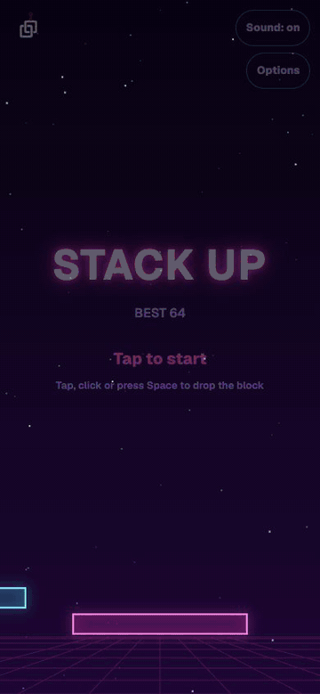
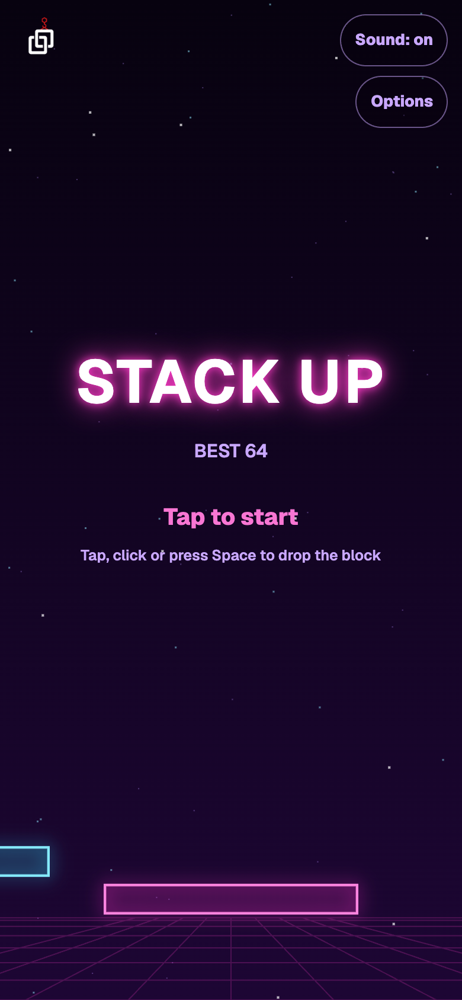
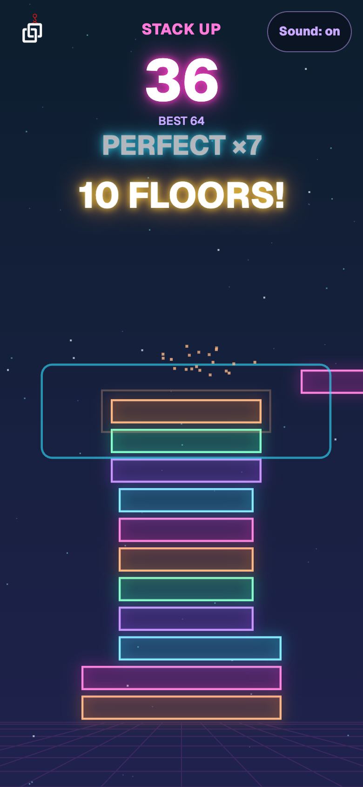
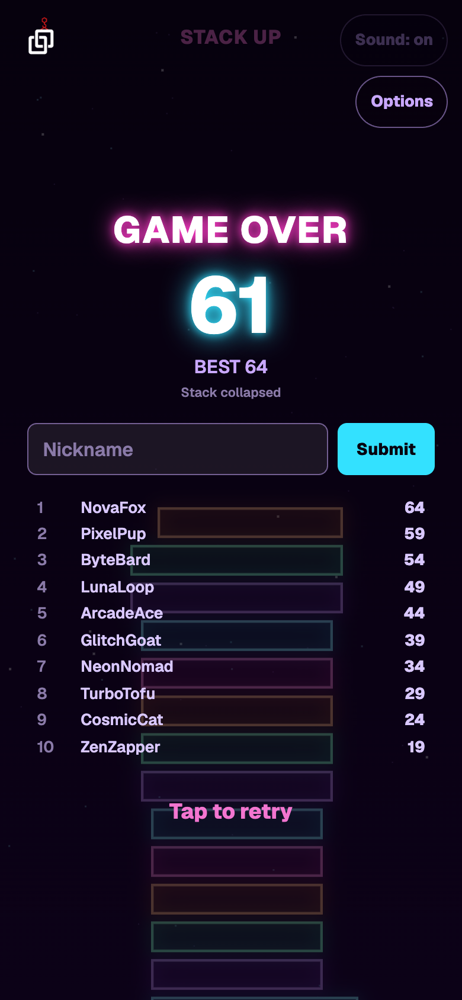
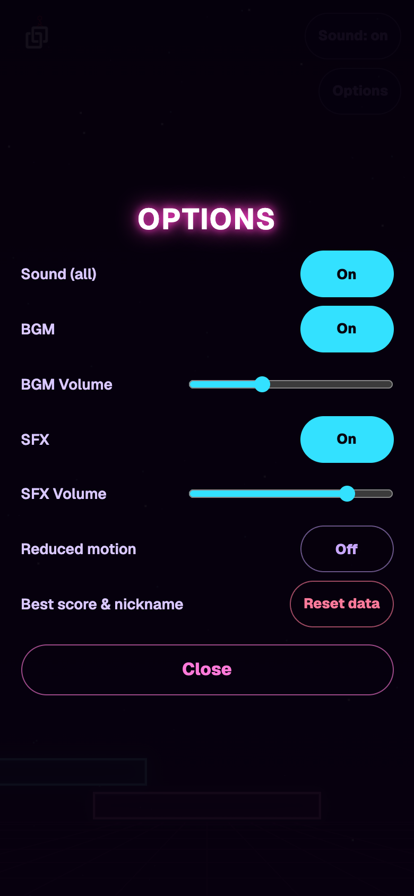

# Stack Up

[](https://github.com/devcol-main/Stack-Up/actions/workflows/ci.yml)

**English** · [한국어](README.ko.md)

A one-tap neon stacking game. A block slides back and forth; tap to drop it, and whatever overhangs the tower is sliced off. Land it dead on for a Perfect, keep the chain going, and see how high you can get before the stack collapses. Built with TypeScript, Canvas 2D and WebAudio — no game engine, no external CDN, and not a single audio file: every sound and the soundtrack are synthesized in code.

<p align="center">
  
</p>

<sub>The clip and the screenshots come from a seeded run played by a bot (`npm run media`). Everything you see is what the real game draws. The leaderboard names are made-up samples.</sub>

| Title | Playing | Game over | Options |
|:---:|:---:|:---:|:---:|
|  |  |  |  |

## How to play

| Input | Action |
|---|---|
| Click / tap anywhere | Drop the block (on the title screen: start; on game over: retry) |
| `Space` | Same as a tap (ignores key auto-repeat) |
| `M` | Mute / unmute everything |
| `Esc` | Close the options panel |

The Options button opens a panel for BGM and SFX (on/off and volume), reduced motion, and a two-step reset of your best score and Top 10. While the panel is open, game input is ignored.

### Rules

- A block slides left and right above the tower. Drop it to stack it on the block below.
- The part that overhangs the block below is sliced off and falls away, so the tower gets narrower after every imperfect drop.
- A drop that lands within a small tolerance of the block below is a **Perfect**: nothing is cut and the block snaps into place at full width.
- Every **5th Perfect in a row** regrows the block by 8% of the starting width, up to the starting width (W0) but never beyond it.
- A drop that misses the tower completely ends the game. Any imperfect (cut) drop resets your combo.
- The block starts from alternating sides each floor, and it can slide partly off screen (up to 90% of its width) before turning back.

### Scoring

- Every floor gives **1 point**.
- A Perfect adds a bonus equal to your current combo, capped at **5**: points for a Perfect = 1 + min(combo, 5), so 2, 3, 4, 5, then 6 per floor from the 5th Perfect in a row.
- Milestones at **5 floors, then 10, 20, 30 …** get a popup (`N FLOORS!`), a sound and a background flash. They do not add points.
- Your best score is kept, and the Top 10 shows score, floors and best combo.

### Difficulty curve

Only speed changes. Speed is in play-area widths per second and grows with the floor:

| | Value |
|---|---|
| Starting speed (floor 1) | 0.4 |
| Increase per floor | +0.025 |
| Cap | 1.2 (reached at floor 33) |

The Perfect tolerance scales with the block: 4.5% of its current width, never less than 0.006 of the play-area width. So the narrower your tower gets, the less forgiving a Perfect is in absolute terms, down to the 0.006 floor. The starting block is 55% of the play-area width. All of this lives in [`src/core/config.ts`](src/core/config.ts).

## Design notes

### Neon

The background fades from near-black at the top to deep purple at the bottom, with a perspective grid that flickers faintly and three layers of drifting stars with parallax as the camera climbs. Blocks are translucent with a bright outline and a glow, cycling through five neon colors (magenta, cyan, violet, mint, orange). The glow comes from sprites prepared once, not from per-frame blur.

### Feel of the drop

- Cut pieces tumble off with gravity and a spin, from a fixed-size pool.
- A **Perfect** draws a square shockwave around the block and throws particles. Both grow with your combo, and the ring turns cyan from combo 3.
- The Perfect sound climbs a major pentatonic scale as the combo grows, so a streak is audible.
- A regrow stretches a white outline from the old width to the new one with a rising arpeggio.
- Milestones flash the background in alternating magenta and cyan and play a short fanfare.
- Game over shakes the screen briefly, drops the missed block, and shows `GAME OVER` and `Stack collapsed`. Input is locked for 0.3 s after game over so a frantic last tap does not skip the results.

### Audio

Everything is synthesized with WebAudio: a 108 BPM A minor pentatonic arpeggio over a sawtooth bass with hi-hats, plus effects for landing, cutting, Perfect, regrow, milestones and game over. BGM and SFX have separate toggles and volumes, and the music is ducked during game over.

### Accessibility and robustness

- **Reduced motion** (from the OS setting or the options panel) removes the screen shake, shrinks particles and shockwaves, slows the star flow, calms the grid flicker, and softens the milestone flash.
- The game pauses when the tab is hidden and resumes when you come back, and it resizes with the window or iframe, including on portrait phones.
- The play area is capped at a 9:16 aspect ratio, so wide screens use a centered vertical strip.

## Technical notes

### Structure

```
src/
  core/     pure game logic: no DOM, Canvas, Audio or storage
  view/     Canvas rendering, camera, background, VFX, glow sprite cache
  audio/    WebAudio synthesis, BGM scheduler, audio settings
  ui/       screen flow, HTML overlays, options, records
  shared/   leaderboard and player profile (shared format with other DevCol games)
  main.ts   the game loop and input
tests/      Vitest
```

### A deterministic core

`core/` knows nothing about screens. `StackUpLogic` takes `update(dt)` and `drop()` and emits a list of events (land, perfect, cut, regrow, milestone, game over). Randomness comes from an injected seeded generator, so the same seed and the same inputs always produce the same game. That is what lets `npm run media` replay the same run every time. The view, the audio and the HUD all react to the same event list.

### Rendering

- **No `shadowBlur` per frame.** Glowing blocks are drawn once to offscreen canvases as 9-slice sprites when the size changes, then copied with `drawImage`.
- **Pooled effects.** Particles, rings, flashes and falling pieces use fixed-size pools.
- **Device pixel ratio** is capped at 2.

### Audio

All sound is generated at runtime with WebAudio, with no audio files. The AudioContext is resumed on the first user input (browser autoplay rules), and a voice limit keeps a busy drop from clipping.

### Storage and leaderboard

Everything lives in `localStorage` behind `try/catch`, so the game still runs where storage is blocked.

| Key | What |
|---|---|
| `stackup.best` | Best score |
| `stackup.leaderboard` | Local Top 10 |
| `stackup.muted` | Mute state |
| `stackup.audio` | BGM/SFX toggles and volumes |
| `stackup.reducedMotion` | Manual reduced-motion setting |
| `devcol.player.id`, `devcol.player.nickname` | Shared player profile |
| `devcol.player.token`, `devcol.player.lbEntries` | Online leaderboard owner token and own entry ids (shared) |

On devcol.net the Top 10 comes from the shared online leaderboard (`a.devcol.net/lb`, server in [devcol-analytics](https://github.com/devcol-main/devcol-analytics)). No login: the first submit gets a random owner token, which is needed to delete your own online scores (Options → Online scores → Delete mine). The player ID is never sent. Names are checked on the server; offensive ones are shown as `Player####`. Every score is also saved locally, and when the server can't be reached the game shows the local board with an "Offline" note. Outside devcol.net (local dev) it is local only; `npm run dev` with `?lb=http://localhost:8787/lb` talks to a local Worker.

The leaderboard sits behind the `LeaderboardService` interface (`OnlineLeaderboardService` wraps `LocalLeaderboardService`). The player profile (one ID and nickname) in [`src/shared/`](src/shared/) is shared at runtime with [Bug Squash](https://github.com/devcol-main/Bug-Squash) when both games are served from the same domain, so the format must stay in sync with that repository. The old `stackup.nickname` key is read once for migration and not written again.

### Size

The production build is **124 KB** including the font and logo (no audio files), checked against a 300 KB limit in CI.

### Screenshots and GIF

[`scripts/capture-media.mjs`](scripts/capture-media.mjs) (`npm run media`) plays a seeded run with a bot in headless Chrome and writes the screenshots and the GIF to `docs/media/`. Re-run it after visual changes.

## Getting started

Requires Node.js 24 (see [`.nvmrc`](.nvmrc)).

```bash
npm ci
npm run dev      # http://localhost:5173
```

| Command | What it does |
|---|---|
| `npm run dev` | Dev server |
| `npm run check` | `tsc --noEmit` + Vitest |
| `npm test` | Vitest only |
| `npm run build` | Production build to `dist/` (relative paths, no CDN) |
| `npm run media` | Regenerates `docs/media` (needs Google Chrome and `ffmpeg`) |

Check the bundle after a build with `bash scripts/verify-build.sh` (size limit 300 KB, no dev-only hooks in the bundle).

To embed in the site:

```bash
npm run build
bash scripts/copy-to-site.sh
```

This copies `dist/` to `../devcol-site/devcol-build/docs/public/games/stack-up/`.

## Development workflow

The game was developed spec-first (see [`CLAUDE.md`](CLAUDE.md)):

- Each change starts as a written spec in [`docs/tasks/`](docs/tasks/) with a checklist. Specs written before the split refer to the old monorepo paths.
- Work is split into sub-tasks (core and tests, rendering, effects and audio, UI, polish). An implementer agent writes the code, a test-runner agent runs `npm run check`, and a reviewer agent reviews the diff. There are hard loop limits, and every sub-task is logged in [`docs/pipeline-log.md`](docs/pipeline-log.md), mistakes included.
- Checks a test cannot make (feel, sound balance, real devices) are listed for a human at the end of each task.
- [`.github/workflows/ci.yml`](.github/workflows/ci.yml) runs on pull requests and pushes to `main`: `npm ci`, `npm run check`, `npm run build`, then `scripts/verify-build.sh`.

## Related

- [devcol-main/Arcade-Web](https://github.com/devcol-main/Arcade-Web): the repository Stack Up was split out of, with its history preserved.
- [devcol-main/Bug-Squash](https://github.com/devcol-main/Bug-Squash): a sibling DevCol browser game. It shares the player profile format.

## Licenses

- Code: [Apache License 2.0](LICENSE). See [`NOTICE`](NOTICE).
- Font: Geist, SIL Open Font License 1.1, bundled with its license in `public/licenses/`.
- DevCol logo (`src/assets/`): owned by DevCol; not licensed for reuse under Apache-2.0 (see [`docs/assets.md`](docs/assets.md)).
- No audio files: all sound is synthesized in code.
- Screenshots and the GIF in `docs/media/` are captures of this game.
